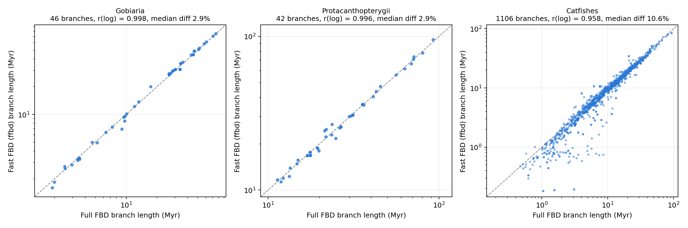

# fast_FBD

A fast Bayesian program for dating phylogenies with fossils, using the **fossilized birth-death (FBD)** process.

> **Status: research software.** The math and sampling have passed strict tests, and Fast FBD matches full-DNA FBD on two test clades. See [Validation](#validation) before using results.

## What it does

FBD dating treats fossils as real tips on the tree, instead of turning them into minimum ages on nodes. That uses all the fossils, not just the oldest ones, but standard programs become extremely slow on large trees.

`ffbd` makes this practical with two ideas:

1. **Fast FBD.** The DNA alignment is summarized once, as a tree of branch lengths with a standard error for each branch. The program then asks how well each proposed set of dates and rates explains those branch lengths, instead of recalculating the full DNA likelihood.
2. **Local updates.** When one age changes, only the affected terms are recalculated. Cost per step does not grow with tree size.

On one CPU core it runs about **2.6 million MCMC proposals per second**, with no slowdown between 1,185 and 2,424 tips.

## What is fixed and what is estimated

| Fixed | Estimated |
|---|---|
| The relationships among living species | Ages of all nodes |
| Sampling fraction of living species (rho) | Speciation, extinction and fossil sampling rates |
| Fossil clade constraints and age windows | Where each fossil attaches, within its constraint |
| | Each fossil's age, within its window |
| | Whether a fossil is a sampled ancestor |
| | Rates of molecular evolution, per branch |

**Use it when** the tree of living species is settled, you have many fossils, and full-DNA FBD is too slow.

**Do not use it when** the topology of living species is in question, or for very short or poorly supported branches where a Normal approximation of branch length is doubtful.

## Install

You need a C++17 compiler and nothing else.

```bash
git clone https://github.com/betanri/fast_FBD.git
cd fast_FBD
make
```

## Quick start

A tiny simulated data set is included (4 living species, 3 fossils):

```bash
mkdir -p runs
./ffbd run examples/example_input.txt --prefix runs/example --seed 1 --gens 2000000 --print 2000 --tree-print 20000 --burnin 100000
```

This takes under a second and writes:

| File | Contents |
|---|---|
| `runs/example.log` | One row per sample: posterior, rates, and the age of each node (`age_n1`, ...), readable in Tracer |
| `runs/example.trees` | Sampled trees with fossils as tips |

Run at least two chains with different `--seed` values and check that they agree.

## What you need

| Input | Notes |
|---|---|
| Rooted tree of living species | Fixed topology |
| Branch lengths and their standard errors | For example ML branch lengths on the fixed tree, with bootstrap standard errors |
| Fossil list | Name, minimum and maximum age |
| Clade constraints | Which fossils belong in which clades |
| Crown or stem rules (optional) | Fossils that must sit inside a crown, or on its stem only (see below) |
| Sampling fraction (rho) | Share of living species included |
| Root age prior | `uniform MIN MAX`, `soft MIN MAX SD P` (soft bounds) or `normal MEAN SD` |
| A valid starting tree | With fossils attached, and consistent with the constraints |

These go in one text file. `examples/example_input.txt` shows every section: the settings, then `tips`, `initial_tree`, `constraints`, `extant_nodes`, `branches` and `terms`. If your inputs are already in RevBayes-style files, `scripts/ffbd_convert.py` builds this file for you.

### Crown and stem rules

A clade constraint says a fossil belongs to a group, and that includes the group's stem. Two optional sections narrow this:

- `crown K` followed by K lines `fossil node`: the fossil may attach only below that extant node, inside the crown. The crown node must then be at least as old as the fossil.
- `stem K` followed by K lines `fossil node`: the fossil may not attach below that extant node. Its clade constraint keeps it in the total group, so it sits on the stem.

`fossil` is the tip index and `node` the extant node index used in the input file. The converter reads them from `crown.tsv` and `stem.tsv` (fossil name, extant node name) in the input folder. The rules only restrict where a fossil can attach; they add no age prior. `examples/example_crown_stem.txt` shows both.

## Main options

| Option | Meaning |
|---|---|
| `--prefix P` | Start of the output file names |
| `--seed S` | Random seed |
| `--gens G` | Number of proposals |
| `--burnin N` | Proposals used to tune moves, not logged |
| `--print N`, `--tree-print N` | How often to log parameters and trees |
| `--checkpoint N`, `--resume` | Save progress and continue a run exactly where it stopped |
| `--mode control` | Run without molecular data, to see what the fossils and priors alone imply |
| `--log-rates` | Also log branch rates |
| `--check` | Check internal consistency while running (slow) |

## The model

- Constant-rate fossilized birth-death process with sampled ancestors, conditioned on the root age. The density matches RevBayes 1.3.2 `dnBDSTP` inside `dnConstrainedTopology`.
- Fossil ages are uniform within their windows.
- Clock: one rate per branch of the living-species tree, exponential by default or uncorrelated lognormal.
- Data: for each branch, observed length ~ Normal(rate x time, standard error). The two branches at the root share one observation.

## Validation

Full details and result files are in [VALIDATION.md](VALIDATION.md) and `validation/`. Status as of 10 November 2026.

| Test | Result |
|---|---|
| Probabilities equal RevBayes 1.3.2 on fixed trees | **Passed**: difference at most 4e-9 on 89 states across 4 data sets |
| Simulation-based calibration, data simulated from known truth (500 replicates, 3 settings) | **Passed** |
| Prior-only run against exact analytic results | **Passed** |
| Internal consistency and exact restart from a checkpoint | **Passed** |
| Agreement with RevBayes with sampled-ancestor changes switched off | **Passed**: node ages differ by 0.3 to 0.4% (median) |
| Agreement with RevBayes with sampled-ancestor changes switched on | **Does not match**, apparently because of a RevBayes move; see below |
| Fast FBD against full-DNA FBD (RevBayes, that move removed), two fish clades | **Passed**: branch lengths in time differ by 2.9% (median), r = 0.998 and 0.996; root ages 75.2 vs 75.1 Ma and 139.0 vs 139.1 Ma |
| Catfish data set (713 living tips, 94 fossils) against the original full analysis | **Close, not identical**: branch lengths r = 0.958, median difference 10.6% (node ages r = 0.994, Fast 1.8 Myr younger on average). The original used a lognormal clock and the RevBayes move above, so some difference is expected |
| Convergence on large trees (1,185 and 2,424 tips) | **Passed**: after 20 billion proposals, main-parameter ESS 500 to 800; two chains agree on node ages to 0.9% (median) |
| Crown and stem rules (new) | **Passed**: an exact conditioning test (below); runs without these rules are byte-identical to the previous release |



*Each point is one branch of the extant time tree (fossils pruned; median node ages), matched by its clade and parent clade. Gobiaria and Protacanthopterygii: full-DNA FBD in RevBayes 1.3.2 with `mvCollapseExpandFossilBranch` removed, against `ffbd` on the same data, priors and fossils. Catfishes: the original published-style full analysis against `ffbd`. Dashed line: equal lengths.*

**Crown and stem test.** On the small example (4 living species, 3 fossils), FOSSIL_1 was given a crown rule and FOSSIL_3 a stem rule on the same node. The run with these rules was compared with unconstrained runs kept only where both rules happened to hold (10.3% of samples). If the rules are implemented correctly, the two must give the same distribution. With 11 seeds per side, the rules held in all 1,100,011 samples. Every quantity agreed within 1.4 standard errors: speciation, extinction, fossil sampling, number of sampled ancestors and all three node ages (`validation/crown_stem_test_11seeds.txt`).

### A difference from RevBayes

`ffbd` and RevBayes 1.3.2 give different posteriors when fossils have age ranges and sampled ancestors can be added or removed. The evidence points to the RevBayes move `mvCollapseExpandFossilBranch`. In the 1.3.2 source, it draws the new attachment age above the *maximum* of the fossil's age window, while the reverse move can start from attachments inside the window. Those states can be left but not re-entered in the same way, so the move is not reversible.

With that move removed from both programs, they agree. `ffbd` also recovers known truth in simulations. We have not yet confirmed this with the RevBayes developers. `--rb-sa-move` imitates that proposal, for testing only.

## Known limits

- The topology of living species cannot change.
- Fossils must fall inside a clade constraint below the root in root-conditioned runs.
- Rates are constant through time (no shifts or mass extinctions).
- The result depends on the quality of the branch lengths and their standard errors.

## Citation and license

Not yet published. No license has been chosen yet, so please contact the author before reusing the code.
