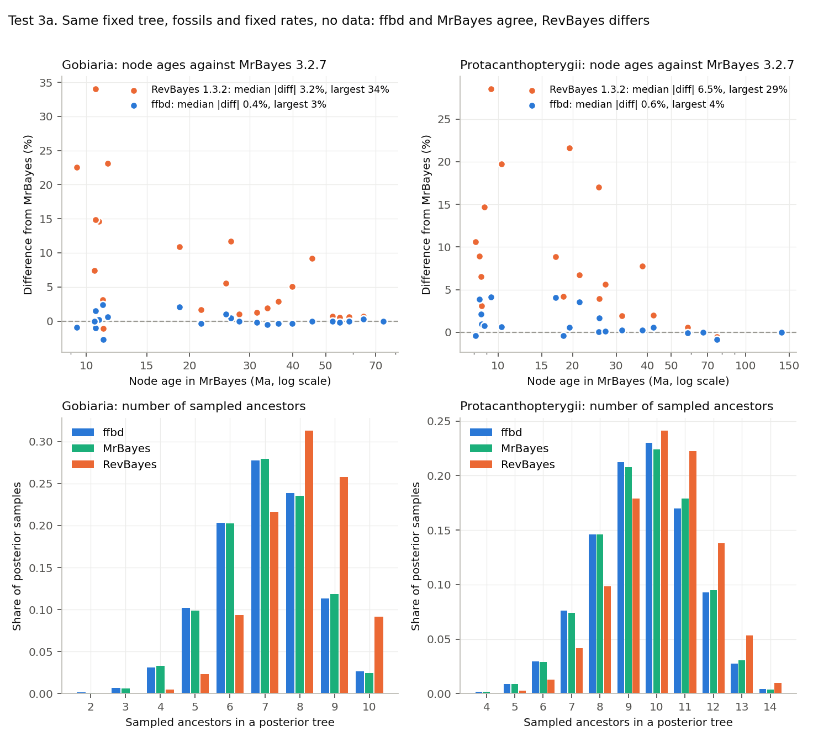
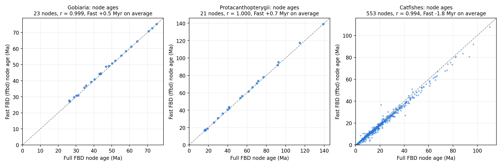
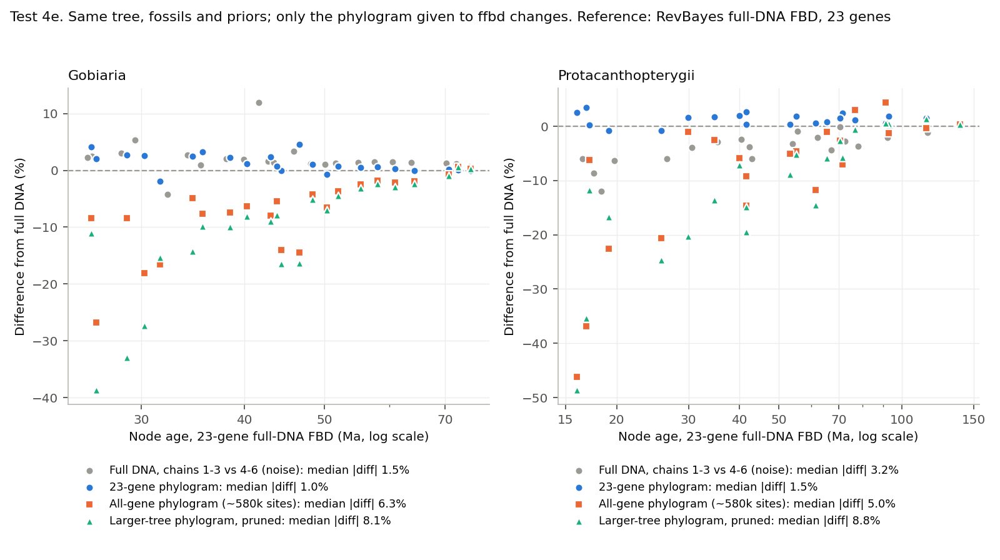

# fast_FBD

A fast Bayesian program for dating phylogenies with fossils, using the **fossilized birth-death (FBD)** process.

> **Status: research software.** The math and sampling have passed strict tests, and Fast FBD (given a phylogram) matches full-DNA FBD (given the DNA) on two test clades. See [Validation](#validation) before using results.

## What it does

FBD dating treats fossils as real tips on the tree, instead of turning them into minimum ages on nodes. That uses all the fossils, not just the oldest ones, but standard programs become extremely slow on large trees.

`ffbd` makes this practical with two ideas, and adds a third step. Two things that full-DNA FBD rarely manages on large trees follow: using all the genes, and choosing the clock by fit.

1. **Fast FBD.** The DNA alignment is summarized once, as a tree of branch lengths with a standard error for each branch. The program then asks how well each proposed set of dates and rates explains those branch lengths, instead of recalculating the full DNA likelihood. Because the DNA is read only once, the branch lengths can come from all the genes of a genome-scale data set. Full-DNA FBD is in practice limited to a few dozen genes.
2. **Local updates.** When one age changes, only the affected terms are recalculated. Cost per step does not grow with tree size.
3. **Clock fitting.** Five clock models are built in. Their marginal likelihoods can be estimated on the same phylogram (`--ss`), so the clock is chosen by fit on the tree being dated, not by habit. With full-DNA FBD, this kind of fitting is practical only for small clades.

On one CPU core it runs about **2.6 million MCMC proposals per second**, with no slowdown between 1,185 and 2,424 tips.

## What is fixed and what is estimated

| Fixed | Estimated |
|---|---|
| The relationships among living species | Ages of all nodes |
| Sampling fraction of living species (rho) | Speciation, extinction and fossil sampling rates |
| Fossil clade constraints and age windows | Where each fossil attaches, within its constraint |
| Clock model (chosen by fit beforehand; see [Choosing the clock](#choosing-the-clock)) | Clock parameters (mean rate, and the rate variation of the chosen clock) |
| | Each fossil's age, within its window |
| | Whether a fossil is a sampled ancestor |
| | Rates of molecular evolution, per branch |

**Use it when** you have many fossils and a tree of living species estimated from genomic data, and full-DNA FBD is too slow.

**Tree uncertainty.** `ffbd` does not estimate the topology of living species: it dates a given tree. To carry topological uncertainty into the dates, date several trees and report the spread of ages across them. Good choices are trees estimated from different subsets of the genomic data (for example, different sets of loci), each by both concatenation and coalescent (species-tree) methods (as in Rincon-Sandoval et al. 2020, 2024; Santaquiteria et al. 2021, 2025). In one way this is a stronger test than dating trees from one Bayesian posterior: posterior trees all come from the same alignment and model, while trees from different subsets rest on different data. Coalescent trees give branch lengths in coalescent units, so first estimate substitution branch lengths on each topology from the alignment, for example ML branch lengths on the fixed tree; `ffbd` needs substitutions per site. Each tree takes hours with `ffbd`, so dating tens of trees is practical.

**Be careful with** very short or poorly supported branches, where a Normal approximation of branch length is doubtful.

## Install

You need a C++17 compiler and nothing else.

```bash
git clone https://github.com/betanri/fast_FBD.git
cd fast_FBD
make
```

## Quick start

The quick start uses real data: the 8 living and 14 fossil bears of the RevBayes FBD tutorial (fossils after Heath et al. 2014; branch lengths and standard errors from the tutorial's cytochrome b alignment), in `examples/bears_input.txt`. Every step takes seconds. A tiny simulated set (4 living species, 3 fossils) used by the tests is in `examples/example_input.txt`.

**Step 1. Choose the clock (highly recommended).** Fit the five clock models and list them from best to worst fit ([Choosing the clock](#choosing-the-clock) explains how to read the result):

```bash
mkdir -p runs
for c in exp ln gam igr acln; do
  ./ffbd run examples/bears_input.txt --prefix runs/clock_$c --clock $c --seed 1 --burnin 100000 \
      --ss 32 --ss-burn 100000 --ss-gens 1000000 --ss-every 200
done
grep -hv '^clock' runs/clock_*.ml.tsv | sort -t$'\t' -k7,7gr | cut -f1,7,8   # clock, stepping-stone, path sampling; best first
```

On the bears, `igr`, `acln` and `ln` tie (within 0.5 log units over three seeds) and beat `gam` by about 2.5 and `exp` by about 3.5 log units. Those gaps are below 5, so the cytochrome b data only weakly prefer the top clocks: date with the top one and check the runner-up.

**Step 2. Date with the best clock.** Run two chains:

```bash
for s in 1 2; do
  ./ffbd run examples/bears_input.txt --prefix runs/bears_r$s --clock igr --seed $s --gens 100000000 --print 50000 --tree-print 500000 --burnin 1000000
done
```

Each chain takes about 15 seconds and writes:

| File | Contents |
|---|---|
| `runs/bears_r1.log` | One row per sample: posterior, rates, and the age of each node (`age_ursinae`, ...), readable in Tracer |
| `runs/bears_r1.trees` | Sampled trees with fossils as tips |

Always run at least two chains with different `--seed` values and check that they agree. Here the two bear chains agree on node ages to about 1% (the crown of living bears at about 21 Ma).

### Choosing the clock

**Highly recommended before dating: choose the clock by fit.** `ffbd` has five clock models (`--clock`), and on the same DNA a different clock moved some dates by about 10 million years (test 5b), more than the phylogram shortcut ever does. Fit all five on your own phylogram, then date with the best one.

| Clock | Each branch rate |
|---|---|
| `exp` | Exponential around the mean rate |
| `ln` | Lognormal around the mean rate (uncorrelated) |
| `gam` | Gamma around the mean rate |
| `igr` | Gamma whose spread shrinks on longer branches (independent gamma rates, as in MrBayes) |
| `acln` | Lognormal around the rate of its parent branch (autocorrelated) |

To choose one, estimate the marginal likelihood of each by stepping-stone sampling (`--ss K`, with K+1 powers between posterior and prior), then keep the highest. Step 1 of the quick start shows the commands; on the example this takes a few seconds per clock.

- **Reading the result.** A difference of more than about 5 log units is strong evidence for the better clock. Smaller differences mean the data hardly prefer one clock; report the dates under the top two clocks.
- **Settings for real trees.** Use many more proposals per power: test 5c uses 64 powers, each with 250 million proposals after 50 million of burn-in. Repeat with a second seed to check that the estimate is stable.

## What you need

| Input | Notes |
|---|---|
| Rooted tree of living species | Fixed topology |
| Branch lengths and their standard errors | For example ML branch lengths on the fixed tree, with bootstrap standard errors |
| Fossil list | Name, minimum and maximum age |
| Clade constraints | Which fossils belong in which clades |
| Crown or stem rules (optional) | Fossils that must sit inside a crown, or on its stem only (see below) |
| Sampling fraction (rho) | Share of living species included |
| Root age prior | `uniform MIN MAX`, `soft MIN MAX SD P` (soft bounds) or `normal MEAN SD` |
| Clock model | Chosen by fitting the five clocks on your phylogram (highly recommended; [Choosing the clock](#choosing-the-clock)), then set with `--clock` |
| Starting tree (optional) | **Built automatically** by `scripts/ffbd_convert.py`. Give your own `initial.nwk` only if you want a particular start |

These go in one text file. `examples/example_input.txt` shows every section: the settings, then `tips`, `initial_tree`, `constraints`, `extant_nodes`, `branches` and `terms`. If your inputs are already in RevBayes-style files, `scripts/ffbd_convert.py` builds this file for you.

**You do not need a starting tree.** MCMC needs one valid tree to start from: fossils attached, every constraint, crown or stem rule and calibration satisfied. If the input folder has no `initial.nwk`, the converter builds one:

- each fossil goes on the stem of its clade, at its minimum age;
- crown-rule fossils go inside the crown;
- node ages are pushed up wherever a fossil or calibration needs it.

It prints `starting tree built automatically`. `--write-start FILE` saves the tree, and `--auto-start` uses it even when `initial.nwk` exists. The start does not affect the result: from an automatic and from a supplied start, the node ages agree within chain noise (test 6d).

### Crown and stem rules

A clade constraint says a fossil belongs to a group, and that includes the group's stem. Two optional sections narrow this:

- `crown K` followed by K lines `fossil node`: the fossil may attach only below that extant node, inside the crown. The crown node must then be at least as old as the fossil.
- `stem K` followed by K lines `fossil node`: the fossil may not attach below that extant node. Its clade constraint keeps it in the total group, so it sits on the stem.

`fossil` is the tip index and `node` the extant node index used in the input file. The converter reads them from `crown.tsv` and `stem.tsv` (fossil name, extant node name) in the input folder. The rules only restrict where a fossil can attach; they add no age prior. `examples/example_crown_stem.txt` shows both.

## Main options

| Option | Meaning |
|---|---|
| `--prefix P` | Start of the output file names |
| `--seed S` | Random seed |
| `--gens G` | Number of proposals |
| `--burnin N` | Proposals used to tune moves, not logged |
| `--print N`, `--tree-print N` | How often to log parameters and trees |
| `--checkpoint N`, `--resume` | Save progress and continue a run exactly where it stopped |
| `--mode control` | Run without molecular data, to see what the fossils and priors alone imply |
| `--log-rates` | Also log branch rates |
| `--clock exp\|ln\|gam\|igr\|acln` | Clock model. Always set it, after fitting the clocks ([Choosing the clock](#choosing-the-clock)). If omitted, `exp` is used and a warning is printed |
| `--ss K --ss-gens G` | Instead of a normal run, estimate the marginal likelihood of the phylogram by stepping-stone sampling with K+1 powers, to compare clock models |
| `--check` | Check internal consistency while running (slow) |

## The model

- Constant-rate fossilized birth-death process with sampled ancestors, conditioned on the root age. The density matches RevBayes 1.3.2 `dnBDSTP` inside `dnConstrainedTopology`.
- Fossil ages are uniform within their windows.
- Clock: one rate per branch of the living-species tree, with mean rate m ~ Exp(10). Five clock priors (`--clock`):
    - `exp`: each rate ~ Exponential(mean m).
    - `ln`: uncorrelated lognormal, mean m.
    - `gam`: each rate ~ Gamma(shape k, mean m).
    - `igr`: independent gamma rates as in MrBayes; the rate variance shrinks on longer branches.
    - `acln`: autocorrelated lognormal; each branch's rate is centered on its parent branch's rate, with variance growing with branch duration.
- The clock with the best fit can be chosen by marginal likelihood (`--ss`; test 5c).
- Data: for each branch, observed length ~ Normal(rate x time, standard error). The two branches at the root share one observation.

## Validation

Status as of 13 November 2026. All numbers, per-test details and result files are in [VALIDATION.md](VALIDATION.md) and `validation/`, with the same test numbers as here.

`ffbd` is new code, and it replaces the DNA with a phylogram. Both need to earn trust. The validation follows the standard recipe for Bayesian software (Cook et al. 2006; Talts et al. 2018; Mendes et al. 2025) and for FBD simulation studies (Heath et al. 2014; Barido-Sottani et al. 2019). It is organized as six questions. For each one: why it matters, how it was tested, and the answer.

### Short answers

| # | Question | Answer |
|---|---|---|
| 1 | Does `ffbd` compute the FBD probability correctly? | **Yes.** Every term matches RevBayes to within 4e-9 (rounding error). |
| 2 | When the true answer is known, does it find it? | **Yes.** Simulations with known truth pass on trees of 2 to 8,056 living species. |
| 3 | Does an independent program give the same answer? | **Yes.** MrBayes agrees within 0.5%. RevBayes 1.3.2 differs because of one move; with that move off, it agrees too. |
| 4 | Does the phylogram shortcut give the same dates as the DNA? | **Yes, under the same model.** The differences are as small as those between DNA chains of the same analysis. |
| 5 | What changes the dates more than the shortcut does? | **The genes behind the branch lengths, and the clock model.** The sampling fraction matters less. |
| 6 | Does it work on large trees? | **Yes.** Chains converge at 2,424 species, and speed does not drop with tree size. |

### Three kinds of data

`ffbd` never reads DNA. Its data are a **phylogram**: the branch lengths of the fixed tree of living species, in substitutions per site, each with a standard error, estimated once from the DNA. Each test is labeled by what it uses:

- **No data**: fossils and priors only. This isolates the tree and fossil part of the model, where programs differ most.
- **Phylogram**: branch lengths and standard errors, estimated from DNA or simulated.
- **DNA**: the full alignment, analyzed by RevBayes or MrBayes as the reference. `ffbd` then gets a phylogram estimated from that same DNA.

The real test clades are Gobiaria (24 living species, 10 fossils) and Protacanthopterygii (22 living species, 14 fossils), each with 23 genes (16,107 sites), plus catfishes (713 living species, 94 fossils) and the RevBayes bear tutorial.

### 1. Does `ffbd` compute the FBD probability correctly?

**Why it matters.** Every result rests on the probability of a dated tree given the fossils and branch lengths. A small error there biases everything.

**How it was tested.** *No data and phylogram.* Fixed trees and parameter values were scored by `ffbd` and by RevBayes, the established FBD program, term by term: tree density, root prior, rate priors, branch-length terms and fossil windows. 89 states on 4 data sets.

**Answer.** The totals match to within 4e-9, which is rounding error (test 1).

### 2. When the true answer is known, does it find it?

**Why it matters.** Correct probabilities are not enough; the sampler also has to explore them correctly. Bugs in proposals or bookkeeping show up only here.

**How it was tested.** *No data, and simulated phylograms.* Hundreds of data sets were simulated from the model with known true values, using separate simulation code. If the sampler is correct, the true value falls at a random position among the posterior samples, so its rank is uniform. This is simulation-based calibration (SBC).

- **2a.** Small trees, 500 replicates in each of 3 settings, 13 quantities.
- **2b.** Realistic trees, 500 replicates of 2 to 8,056 living species and up to 15,838 fossils, 9 quantities.
- **2c.** A 3-species case with an exact answer.

**Answer.** All passed. Testing found and fixed two bugs along the way (a cached rate sum and a checkpoint restart), and all tests were rerun after the fixes.

### 3. Does an independent program give the same answer?

**Why it matters.** Two programs written from the same equations can still share a mistake in the way they move through tree space. Agreement between independent code is strong evidence.

**How it was tested.** *No data.* `ffbd`, MrBayes 3.2.7 and RevBayes 1.3.2 got the same fixed tree of living species, the same fossils with age windows, and the same fixed speciation, extinction, fossil sampling and root age (test 3a). With no data, all three should give the same node ages and the same number of sampled ancestors, meaning fossils that sit directly on a branch rather than on a side branch. Test 3b reran RevBayes with one move switched off.

**Answer.** `ffbd` and MrBayes agree (node ages within 0.4 to 0.6%, the same number of sampled ancestors). RevBayes finds about one extra sampled ancestor and makes young nodes up to a third older. The likely cause is the RevBayes move `mvCollapseExpandFossilBranch`, which is not reversible when fossils have age ranges (details in VALIDATION.md). With it off, RevBayes agrees with `ffbd` within 0.4% (test 3b). The RevBayes developers have not yet confirmed this. BEAST2 was not used, because it cannot hold the tree of living species fixed while fossils move.



*Test 3a.* Each dot is a node. Top: how far each program is from MrBayes, in %. Blue (`ffbd`) sits on zero; orange (RevBayes) sits above it, mostly on young nodes. Bottom: the number of sampled ancestors per tree. `ffbd` and MrBayes match; RevBayes is shifted by about one.

### 4. Does the phylogram shortcut give the same dates as the DNA?

**Why it matters.** This is the question that matters most in practice. The shortcut is what makes `ffbd` fast, so it must not change the answer.

**How it was tested.**

- **4a. Same DNA, same model.** *DNA vs phylogram.* RevBayes ran full-DNA FBD on the 23 genes of each test clade (6 chains of 22 to 25 hours each, with the move from test 3 removed). `ffbd` got the phylogram estimated from the same 23 genes, with the same fossils, priors and clock.
- **4b. Simulated DNA, known true ages.** *Phylogram from simulated DNA.* 100 simulated trees of 30 to 120 species, with DNA simulated on them, analyzed exactly as for real clades.
- **4c. Catfishes.** *DNA vs phylogram.* An earlier full-DNA analysis of 713 species. It is not like for like, because it used another clock and the RevBayes move from test 3.

**Answer.**

- **4a.** The ages agree to 1.3 and 1.8% at the median, which is no more than the DNA chains differ from each other (1.5 and 3.2%). Roots agree to 0.1 Myr.
- **4b.** The true ages fall inside the 95% interval 91% of the time with the shortcut, against 93% with exact branch lengths. Nodes under 5 Ma come out about 1 Myr too old with or without the shortcut, so that bias comes from the model and priors.
- **4c.** The ages are close (r = 0.994), but not identical.



*Tests 4a and 4c.* Each dot is a node. Horizontal: its age from full-DNA FBD. Vertical: its age from `ffbd`. On the diagonal means the same age.

### 5. What changes the dates more than the shortcut does?

**Why it matters.** If the shortcut is not the weak link, users should know what is.

**How it was tested.**

- **5a. Which genes.** *DNA vs several phylograms.* Everything stayed the same except the phylogram given to `ffbd`: one from the same 23 genes, one from all genes (about 1,100 genes, 580,000 sites), and one from a genome-scale phylogram of a larger tree, pruned to the clade.
- **5b. Which clock, by a second DNA program.** *DNA vs phylogram.* MrBayes ran full-DNA FBD on the same 23 genes. MrBayes cannot run the clock that `ffbd` and RevBayes use (one exponential rate per branch), so it used independent gamma rates (IGR).
- **5c. Which clock fits best.** Clocks are compared by marginal likelihood, which measures how well each model predicts the data while penalizing extra flexibility (stepping-stone sampling; Xie et al. 2011). There are two complementary fits:
    - *DNA.* RevBayes on the 23 genes of the two test clades, with six clocks: strict, exponential (the clock used in tests 1 to 5b), lognormal, gamma, IGR and autocorrelated lognormal. Node ages are either fixed at the DNA estimates or estimated with fossil minimum ages.
    - *Phylogram.* `ffbd` itself (`--ss`) on the 1,184-species phylogram used for dating, with all five `ffbd` clocks.

    The best-fitting clock will be used for the final dates. With full-DNA FBD, this kind of clock fitting is practical only on small clades (see "Why `ffbd` may do better" below); `ffbd` can do it on the full tree being dated. Three of the clocks (gamma, IGR, autocorrelated lognormal) and the stepping-stone code are new, so they first passed the same kinds of checks as questions 1 and 2:
    - their prior densities match an independent implementation (scipy) to rounding error;
    - with no data they recover their priors exactly;
    - on a small example, the stepping-stone estimate matches a brute-force average of the likelihood over 500,000 prior draws within Monte Carlo error;
    - with the exponential clock, the program gives byte-identical output to the previous version.
- **5d. Sampling fraction.** *Phylogram.* `ffbd` fixes rho, the fraction of living species in the tree. A 1,184-species phylogram (pruned from a genome-scale phylogram of a larger tree) with 1,588 fossils was dated at rho = 3.25, 10, 15, 25 and 50%.
- **5e. More genes, known truth.** *Phylograms from simulated DNA.* Gene sets were simulated on the 100 trees of test 4b. The genes differ the way real genes do: each has its own rate, base composition and rate variation, and a few are fast, mitochondrial-like genes. There are two sets: 23 genes (about 18,000 sites), and 1,000 genes (about 500,000 sites) that include the 23. Each set was analyzed like the real clades: concatenated, with ML branch lengths on the true tree.

**Answer.**

- **5a. The genes matter.** The 23-gene phylogram reproduces the 23-gene DNA analysis (1.0 and 1.5% at the median). Phylograms from all genes make nodes 2.5 to 3.8 Myr younger on average, still inside the DNA 95% intervals. How the standard errors were computed makes no difference.
- **5b. The clock can matter.** On Gobiaria, MrBayes agrees with both RevBayes and `ffbd` (about 3%). On Protacanthopterygii, the two DNA programs disagree: MrBayes puts the inner nodes about 10 Myr younger, with intervals twice as wide, while `ffbd` stays with RevBayes, whose clock it shares.
- **5c. Gamma or lognormal, not exponential.** The table gives each clock's log marginal likelihood minus that of the best clock in its column (0 = best; more negative = worse fit; a gap above about 5 log units is strong evidence). DNA columns use ages fixed at the DNA estimates, mean of 2 replicates.

    | Clock | DNA, Gobiaria | DNA, Protacanthopterygii | Phylogram, 1,184 species |
    |---|---|---|---|
    | Gamma | -1.4 | -1.6 | **0** (two seeds: 5,746 and 5,761) |
    | Lognormal | **0** | **0** | -5.3 |
    | Autocorrelated lognormal | -14.9 | -2.7 | -42 |
    | Exponential | -8.7 | -12.2 | -147 |
    | IGR | -27.3 | -35.5 | -464 |
    | Strict | -740 | -523 | not in `ffbd` |

    - **The top two.** Gamma and lognormal lead in every column, within about 5 log units of each other, which is about the gap between the two gamma seeds. The data cannot tell them apart.
    - **The rest.** Exponential, the clock used in tests 1 to 5b, is clearly worse everywhere, decisively on the large phylogram. IGR, the MrBayes clock of test 5b, fits worst of the relaxed clocks. A strict clock is far behind.
    - **Choice.** The final dates use gamma, with lognormal as a check.
    - **Run time.** Each phylogram fit took 2.5 to 3.8 hours on one core. A DNA fit of a single clock on 22 to 24 species took 1.5 to 10 hours on 8 cores in RevBayes.
    - **Cross-check.** With node ages fixed at the MrBayes estimates, or estimated under fossil minimum ages, the relaxed clocks again beat exponential and strict. There the autocorrelated clock leads for Protacanthopterygii, with lognormal within 2.5 log units. The remaining free-age runs will be added when done.
- **5d. Rho matters less.** Raising rho from 3.25 to 50% makes crown ages younger: under 1% at the root (held by its prior) and up to 8% on younger crowns. At rho = 10%, no crown moves more than 2%.
- **5e. More genes are more accurate, modestly.** With 1,000 genes, node ages are closer to the truth on 63% of nodes. The median error drops from 3.55 to 3.39 Myr (3.13 with perfect branch lengths), and 95% coverage rises from 89.5 to 90.7% (93.1% with perfect branch lengths). The gain is largest on nodes under 5 Ma. A 23-gene phylogram gives the same answer as 23-gene DNA (tests 4a and 5a), so this compares full-DNA FBD on the genes it can afford with `ffbd` on genome-scale data.



*Test 5a.* Each dot is a node. Vertical: how far `ffbd` is from the 23-gene DNA analysis, in %. Grey is the noise between DNA chains, blue the 23-gene phylogram, orange the all-gene phylogram and green the pruned larger-tree phylogram. Blue sits with grey; orange and green sit lower (younger).

### 6. Does it work on large trees?

**Why it matters.** Large trees are the reason `ffbd` exists.

**How it was tested.** *Phylogram.*

- **6a. Convergence.** Two independent chains each were run at 1,185 and 2,424 species, with 20 billion proposals each (about 2 hours on one core).
- **6b. Crown and stem rules.** The optional rules that keep a fossil inside or outside a crown group were compared with unconstrained runs filtered to the same rules.
- **6c. Speed.** Speed was measured at both tree sizes.
- **6d. Automatic starting tree.** Starting trees were built automatically for two small clades and for two 1,184-species sets (1,587 and 1,588 fossils, 430 constraints, crown and stem rules, node calibrations). The same analysis was then run from the automatic start and from a supplied one.

**Answer.** The chains converge (effective sample sizes 500 to 800 for the main parameters; the two chains agree on node ages to 0.9% at the median). The rules behave exactly as intended (all quantities within 1.4 standard errors). Every automatic starting tree passes all checks. From the automatic and the supplied start, node ages agree to 0.17 and 0.29% at the median (largest 0.7 and 1.1%), within chain noise. Speed is the same at both sizes, about 2.6 million proposals per second.

### What the validation shows, and what it does not

**It shows that:**

- `ffbd` computes and samples the FBD model correctly (questions 1 and 2).
- An independent program, MrBayes, gives the same answer (question 3).
- Given the same DNA and model, the phylogram shortcut gives the same dates as analyzing the DNA (question 4).

**It does not show that:**

- **The dates are true.** The true ages of real clades are unknown. More genes and better clocks reduce error, but model error remains.
- **The clock is right.** The clock and the genes behind the branch lengths can move dates more than the shortcut does (question 5), so they deserve the same care as fossil choice.
- **Very young nodes are accurate.** Nodes under about 5 Ma tend to come out about 1 Myr too old. This comes from the model and priors, and full-DNA FBD shares it.
- **The topology is right.** Each run dates one tree of living species. Topological uncertainty is covered by dating several trees (see Tree uncertainty, above).

### Why `ffbd` may do better than full-DNA FBD on real data

Full-DNA FBD is slow, and that forces two compromises in practice. `ffbd` removes both.

**1. All the genes, not a few dozen.**

- **Full-DNA FBD in practice** is run on a few dozen genes or fewer. Here, RevBayes on 23 genes and about two dozen species took 22 to 25 hours per chain and still mixed poorly, so six chains had to be pooled. Running the same analysis on 36 times more sites, or on thousands of species, is out of reach.
- **`ffbd`** reads the DNA only once, as branch lengths, so those can come from every gene of a genome-scale data set.
- **What test 5a shows.** Given the same genes, `ffbd` matches full-DNA FBD, so the shortcut does not change the answer. The data do change it: all-gene branch lengths give ages a few million years younger, and they are 5 to 6 times more precise (standard error relative to branch length).
- **What test 5e shows.** With known true ages, 1,000 genes give more accurate dates than 23: closer to the truth on 63% of nodes, with the largest gain on young nodes. The simulated genes follow the analysis model, so the gain on real data may be smaller or larger.

**2. The clock chosen by fit, not by habit.**

- **Full-DNA FBD in practice.** RevBayes and MrBayes offer several clocks and stepping-stone sampling, but on DNA fitting them is practical only for small clades. Here, one RevBayes stepping-stone run for one clock on 22 to 24 species and 23 genes took 1.5 to 10 hours on 8 cores. Repeating that for every clock on 1,184 species and 1,588 fossils is out of reach, so studies pick one clock and rarely test it.
- **`ffbd`** runs the whole pipeline on the phylogram of the tree actually being dated, one core per clock (2.5 to 3.8 hours each on 1,184 species and 1,588 fossils): it fits five clocks by marginal likelihood, keeps the best, and dates with it.
- **What test 5b shows.** The clock matters. On the same DNA, a different clock moved some dates by about 10 million years.
- **What test 5c shows.** Exponential, which most FBD analyses would simply have used here, fits clearly worse than gamma or lognormal on every data set: by 9 to 22 log units on the DNA of the two small clades, and by about 147 on the 1,184-species phylogram. Each phylogram fit took 2.5 to 3.8 hours on one core.

### Reproducing the tests

| Test | Script | Result file |
|---|---|---|
| 1 | `density_check.py` | `density_check_A06_A12.txt`, `density_check_bears_catfish.txt` |
| 2a | `sbc.py` | `sbc_with_data_500reps.txt`, `sbc_prior_only_500reps.txt`, `sbc_origin_mode_500reps.txt` |
| 2b | `sim_study.py sbc`, `sbc_ranks.py` | `sbc_realistic_500reps.txt`, `sbc_rank_histograms.png` |
| 2c | `analytic_check.py` | `analytic_check.txt` |
| 3a | `make_fixed3.py`, `compare_fixed3.py` | `three_program_prior_A06_A12.txt`, `compare_pilots_summary.txt` |
| 3b | `compare_runs.py` | `E1_noCE_summary.txt` |
| 4a, 4c | `branch_scatter.py --ages-only` | `node_ages_full_vs_fast.tsv` |
| 4b | `sim_study.py simulate`, `sim_study_summary.py` | `sim_study_100reps.txt`, `simulation_coverage_by_age.png` |
| 5a | `ctrl_compare.py` | `phylogram_vs_dna_controlled.txt` |
| 5b | `make_mb_dna.py`, `compare_mbdna.py` | `mrbayes_dna_A06_A12.txt` |
| 5c | `clock_ss.py` (DNA, RevBayes); `ffbd --clock C --ss K` (phylogram); `clock_density_check.py` | `clock_checks.txt`, `clock_fit_results.txt` |
| 5e | `sim_genes.py`, `sim_genes_summary.py` | `sim_genes_100reps.txt` |
| 6b | `examples/example_crown_stem.txt` | `crown_stem_test_11seeds.txt`, `regression_previous_release.txt` |
| 6d | `ffbd_convert.py --auto-start` | `auto_start_check.txt` |
| Figures | `validation_figures.py` | `validation/*.png` |

### References

- Barido-Sottani J, Aguirre-Fernández G, Hopkins MJ, Stadler T, Warnock R (2019). Ignoring stratigraphic age uncertainty leads to erroneous estimates of species divergence times under the fossilized birth-death process. *Proceedings of the Royal Society B* 286: 20190685.
- Cook SR, Gelman A, Rubin DB (2006). Validation of software for Bayesian models using posterior quantiles. *Journal of Computational and Graphical Statistics* 15: 675-692.
- Gavryushkina A, Welch D, Stadler T, Drummond AJ (2014). Bayesian inference of sampled ancestor trees for epidemiology and fossil calibration. *PLoS Computational Biology* 10: e1003919.
- Heath TA, Huelsenbeck JP, Stadler T (2014). The fossilized birth-death process for coherent calibration of divergence-time estimates. *PNAS* 111: E2957-E2966.
- Höhna S, Landis MJ, Heath TA, et al. (2016). RevBayes: Bayesian phylogenetic inference using graphical models and an interactive model-specification language. *Systematic Biology* 65: 726-736.
- Mendes FK, Bouckaert R, Carvalho LM, Drummond AJ (2025). How to validate a Bayesian evolutionary model. *Systematic Biology*, doi:10.1093/sysbio/syae064.
- Rincon-Sandoval M, Duarte-Ribeiro E, Davis AM, et al. (2020). Evolutionary determinism and convergence associated with water-column transitions in marine fishes. *PNAS* 117: 33396-33403.
- Rincon-Sandoval M, et al. (2024). Ecological diversification of sea catfishes is accompanied by genome-wide signatures of positive selection. *Nature Communications* 15: 10040.
- Ronquist F, Teslenko M, van der Mark P, et al. (2012). MrBayes 3.2: efficient Bayesian phylogenetic inference and model choice across a large model space. *Systematic Biology* 61: 539-542.
- Santaquiteria A, Siqueira AC, Duarte-Ribeiro E, et al. (2021). Phylogenomics and historical biogeography of seahorses, dragonets, goatfishes, and allies (Teleostei: Syngnatharia): assessing factors driving uncertainty in biogeographic inferences. *Systematic Biology* 70: 1145-1162.
- Santaquiteria A, Miller EC, Rosas-Puchuri U, Pedraza-Marrón CR, Troyer EM, Westneat MW, Carnevale G, Arcila D, Betancur-R R (2025). Colonization dynamics explain the decoupling of species richness and morphological disparity in syngnatharian fishes across oceans. *The American Naturalist* 205(3), doi:10.1086/733931.
- Talts S, Betancourt M, Simpson D, Vehtari A, Gelman A (2018). Validating Bayesian inference algorithms with simulation-based calibration. arXiv:1804.06788.
- Xie W, Lewis PO, Fan Y, Kuo L, Chen MH (2011). Improving marginal likelihood estimation for Bayesian phylogenetic model selection. *Systematic Biology* 60: 150-160.
- Zhang C, Stadler T, Klopfstein S, Heath TA, Ronquist F (2016). Total-evidence dating under the fossilized birth-death process. *Systematic Biology* 65: 228-249.

## Known limits

- The topology of living species is fixed within a run; date several trees to cover topological uncertainty.
- Fossils must fall inside a clade constraint below the root in root-conditioned runs.
- Rates are constant through time (no shifts or mass extinctions).
- The result depends on the quality of the branch lengths and their standard errors.

## Citation and license

Not yet published. No license has been chosen yet, so please contact the author before reusing the code.
