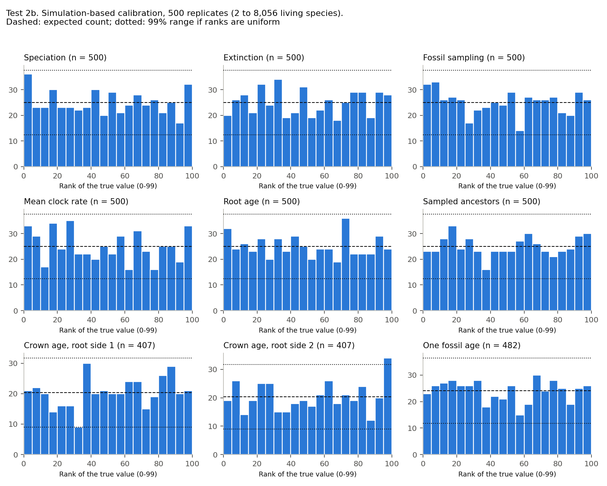
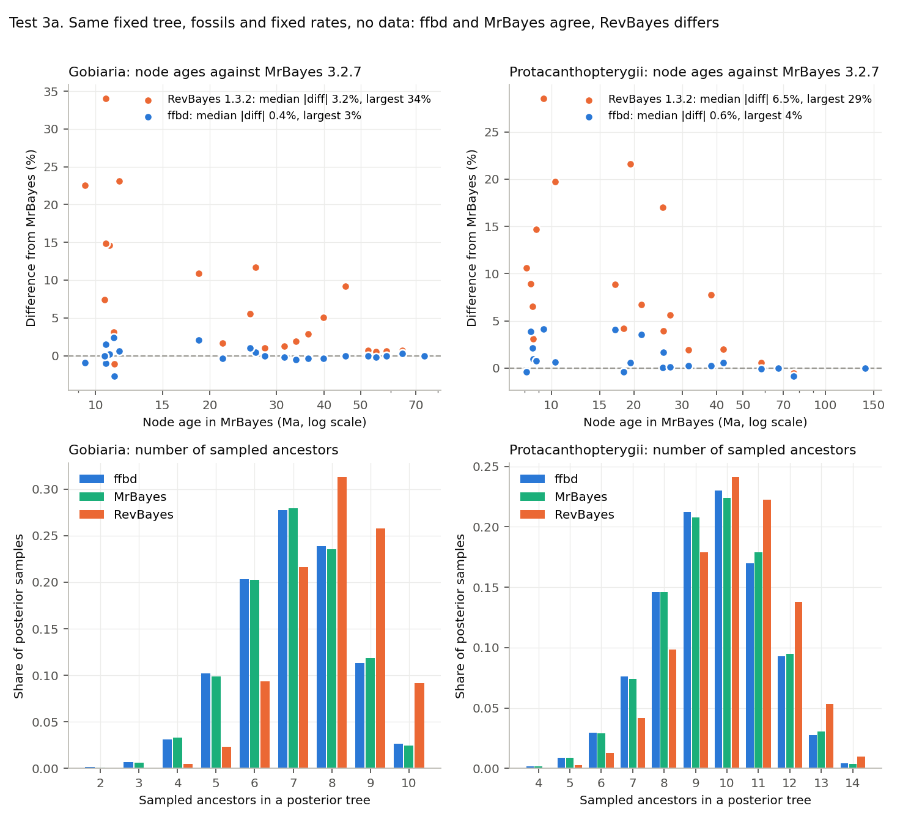
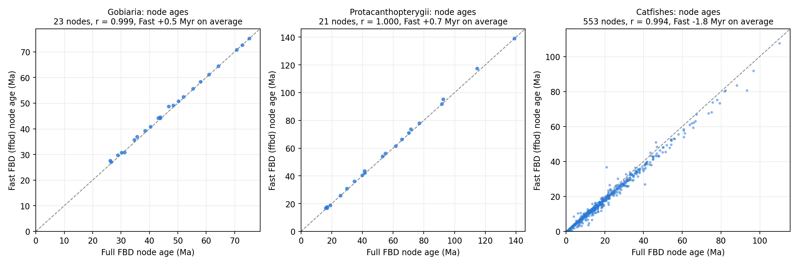
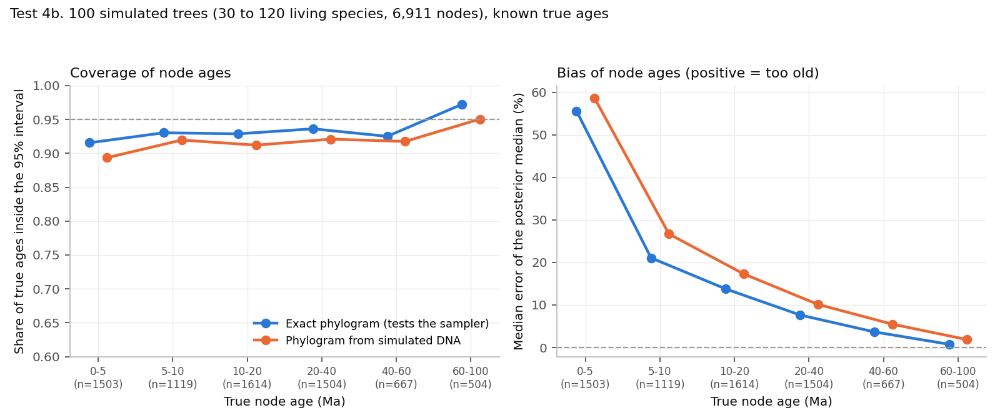
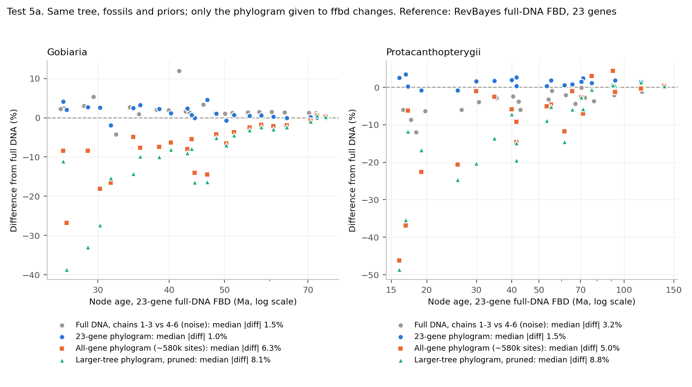

# Validation of ffbd: details

Status as of 13 November 2026. This file holds the numbers behind the [README Validation section](README.md#validation), which gives the plain-language questions, approach and references. Tests are numbered the same way in both. "RevBayes" means RevBayes 1.3.2 and "MrBayes" means MrBayes 3.2.7. Result files and figures are in `validation/`; the scripts are in `scripts/`.

**Data labels.** `ffbd` never reads DNA. Its data are a phylogram: branch lengths of the fixed living-species tree, in substitutions per site, with standard errors.

- **No data**: fossils and priors only.
- **Phylogram**: branch lengths and standard errors, estimated from DNA or simulated.
- **DNA**: the full alignment, analyzed by RevBayes or MrBayes as the reference, while `ffbd` gets a phylogram estimated from the same DNA.

**Data sets.**

- **A06**: Gobiaria, 24 living species and 10 fossils.
- **A12**: Protacanthopterygii, 22 living species and 14 fossils.
- A06 and A12 each have a 23-gene alignment of 16,107 sites.
- **Bears**: the RevBayes tutorial data.
- **Catfishes**: 713 living species and 94 fossils.
- **Simulated** data sets, described under each test.

## Summary

| Question | # | Test | Data | Result |
|---|---|---|---|---|
| 1. Right probabilities | 1 | Every probability term against RevBayes, on fixed trees | No data and phylogram | Passed: difference at most 4e-9 |
| 2. Finds the known truth | 2a | Simulation-based calibration, small trees | No data and simulated phylogram | Passed |
| | 2b | Simulation-based calibration, 2 to 8,056 living species | Simulated phylogram | Passed |
| | 2c | Exact 3-species prior | No data | Passed |
| 3. Independent program agrees | 3a | ffbd, MrBayes and RevBayes on the same fixed-rate prior | No data | ffbd = MrBayes; RevBayes differs |
| | 3b | ffbd and RevBayes with one RevBayes move off | No data | Agree |
| 4. Shortcut = DNA | 4a | ffbd against RevBayes full-DNA FBD | DNA vs phylogram | Agree, within DNA chain noise |
| | 4b | Simulation study, 100 trees of 30 to 120 tips | Phylogram from simulated DNA | Near 95% coverage |
| | 4c | Catfishes against an earlier full-DNA analysis | DNA vs phylogram | Close, not like for like |
| 5. What matters more | 5a | Which phylogram: 23 genes, all genes, larger tree | DNA vs phylograms | 23-gene phylogram = 23-gene DNA; more genes give younger ages |
| | 5b | ffbd against MrBayes full-DNA FBD (IGR clock) | DNA vs phylogram | Gobiaria agrees; Protacanthopterygii is clock-sensitive |
| | 5c | Clock models by marginal likelihood | DNA | Running |
| | 5d | Sampling fraction (rho) | Phylogram | Up to 8% younger at rho 50% |
| 6. Large trees | 6a | Convergence at 1,185 and 2,424 tips | Phylogram | Passed |
| | 6b | Crown and stem rules | Phylogram | Passed |
| | 6c | Speed | Phylogram | No slowdown with size |

## 1. Right probabilities

### Test 1. Probabilities on fixed trees (passed)

*Data: no data and phylogram.* For fixed trees and parameter values, every term was compared with RevBayes: FBD density, root prior, rate priors, data terms and fossil windows (`scripts/density_check.py`).

| Data set | States compared | Largest difference in the total |
|---|---|---|
| A06 | 24 | 3.7e-10 |
| A12 | 24 | 2.8e-9 |
| Bears | 17 of 18 | 2.0e-9 |
| Catfish | 24 | 3.7e-9 |

RevBayes refused to build one bear state, because its origin was below a fossil's window maximum. That is a check at model construction, not a difference in density.

## 2. Finds the known truth

### 2a. Simulation-based calibration, small trees (passed)

*Data: no data, and simulated phylograms.* Data sets were simulated exactly from the model with known true values, using `ffbd_sim` (separate code from the sampler; `scripts/sbc.py`). If the sampler is correct, the rank of each true value among the posterior samples is uniform. There were 500 replicates per setting. 13 parameters were tested by chi-square and Kolmogorov-Smirnov tests, with a Bonferroni threshold of 0.0038.

| Setting | Smallest p-value | Result |
|---|---|---|
| Root-conditioned, with data | 0.014 | Passed |
| Root-conditioned, no data | 0.079 | Passed |
| Origin-conditioned, with data | 0.014 | Passed |

Testing found and fixed two bugs: a cached sum of rates that could become corrupted, and a checkpoint restart that was not exactly reproducible. All tests were rerun after the fixes, and a restarted run now gives byte-identical output.

### 2b. Simulation-based calibration at realistic size (passed)

*Data: simulated phylograms.* Run with `scripts/sim_study.py sbc`.

- **Priors and truth.** Each of 500 replicates draws speciation, extinction, fossil sampling and the mean clock rate from the `ffbd` priors (exponential, rate 10), and the root from the analysis prior Normal(30, 2).
- **Simulation.** It then simulates an FBD tree with no size filter. Only information that is exact for this test is used: fossil windows on a fixed 4-Myr grid, one constraint per side of the root, and a constant observation standard deviation (0.01).
- **Tree sizes.** 2 to 8,056 living tips (median 20) and 0 to 15,838 fossils (median 25).
- **Scoring.** Each replicate ran 100 million proposals, thinned to 99 draws. The rank of the true value among them was scored with `scripts/sbc_ranks.py` (`validation/sbc_realistic_500reps.txt`).
- **Threshold.** Bonferroni for 9 tests: p < 0.0056.

| Quantity | n | Uniformity p (20 bins) | Mean rank (0.5 expected) | Median ESS |
|---|---|---|---|---|
| Speciation | 500 | 0.66 | 0.490 | 361 |
| Extinction | 500 | 0.50 | 0.503 | 361 |
| Fossil sampling | 500 | 0.65 | 0.488 | 361 |
| Mean clock rate | 500 | 0.087 | 0.485 | 320 |
| Root age | 500 | 0.79 | 0.493 | 361 |
| Number of sampled ancestors | 500 | 0.91 | 0.504 | 361 |
| Crown age, root side 1 | 407 | 0.24 | 0.522 | 172 |
| Crown age, root side 2 | 407 | 0.17 | 0.513 | 180 |
| One random fossil's age | 482 | 0.87 | 0.494 | 361 |

Each panel is a histogram of the rank of the true value (0 to 99) over the 500 replicates. A correct sampler gives flat bars. The dashed line is the expected height, and the dotted lines are the 99% range for chance. Low ends would mean intervals too narrow, a central hump intervals too wide, and a slope bias. All nine panels are flat.

### 2c. Exact 3-species prior (passed)

*Data: no data.* An exact analytic check of a 3-species, 1-fossil prior agreed (`scripts/analytic_check.py`; `validation/analytic_check.txt`):

| Quantity | MCMC | Exact |
|---|---|---|
| Sampled-ancestor probability | 0.6871 | 0.6889 |
| Mean fossil age | 4.913 | 4.914 |

## 3. Independent program agrees

### 3a. ffbd, MrBayes and RevBayes on the same prior (ffbd = MrBayes)

*Data: no data.* `scripts/make_fixed3.py` writes the same model for all three programs:

- the A06 or A12 living-species tree, fixed (in MrBayes, one partial constraint per living-species node, with fossils free);
- the same clade constraints;
- uniform fossil age windows (MrBayes `calibrate`);
- speciation 0.10, extinction 0.04, fossil sampling 0.03 and the root age, all **fixed**.

With every rate fixed, the three programs must give the same node ages and the same number of sampled ancestors. There were two chains per program and data set, compared with `scripts/compare_fixed3.py` (`validation/three_program_prior_A06_A12.txt`).

| Data set | Mean sampled ancestors, ffbd / MrBayes / RevBayes | Node ages, ffbd vs MrBayes (median, largest) | RevBayes vs MrBayes (median, largest) | MrBayes chain 1 vs chain 2 (median, largest) |
|---|---|---|---|---|
| A06 | 7.01 / 7.02 / 7.95 | 0.36%, 2.7% | 3.2%, 34% | 0.89%, 7.4% |
| A12 | 9.55 / 9.58 / 10.13 | 0.59%, 4.2% | 6.5%, 28.5% | 0.86%, 6.4% |

`ffbd` and MrBayes agree within chain noise. RevBayes gives about one extra sampled ancestor and older young nodes. The difference is largest on two-tip nodes: for example, 10.6 Ma in MrBayes and 14.2 Ma in RevBayes.

The same pattern appears when RevBayes and `ffbd` are compared directly, with estimated rates (`validation/compare_pilots_summary.txt`):

| Data set | Data | Median difference in node ages | Largest difference |
|---|---|---|---|
| A06 | No data | 1.64% | 12.8% |
| A12 | No data | 4.97% | 8.1% |
| A06 | Phylogram | 1.13% | 21.5% |
| A12 | Phylogram | 2.59% | 13.0% |
| Bears | Phylogram | 8.96% | 12.6% |

RevBayes node-age ESS was low on these runs (32 to 35 per chain on the phylogram runs), so part of each difference is RevBayes sampling noise.

**Explanation.** The cause is the RevBayes move `mvCollapseExpandFossilBranch` (`CollapseExpandFossilBranchProposal.cpp`, v1.3.2):

- When the move adds a sampled ancestor's branch, it draws the new age from above the maximum of the fossil's age window.
- The reverse move can start from attachments inside the window, and the forward move cannot reach those.
- So the move is not reversible for fossils with age ranges.

Four results support this:

1. The probabilities are identical (test 1).
2. The two programs agree once the move is removed (test 3b).
3. `ffbd` recovers the truth in simulation (tests 2a to 2c).
4. MrBayes, written independently, agrees with `ffbd` (this test).

This has not yet been confirmed with the RevBayes developers. `ffbd --rb-sa-move` imitates that proposal, for testing only.

**BEAST2.** The sampled-ancestor package of BEAST2 (Gavryushkina et al. 2014) was not used. Its clade constraints count fossils as clade members, so it cannot hold the living-species tree fixed while fossils move within their clades.

### 3b. ffbd and RevBayes with the collapse-expand move off (passed)

*Data: no data.* `scripts/compare_runs.py`; `validation/E1_noCE_summary.txt`.

| Data set | Node-age medians, median difference | Largest difference | Two RevBayes chains differ by (median) |
|---|---|---|---|
| A06 | 0.28% | 1.44% | 0.59% |
| A12 | 0.41% | 1.44% | 0.70% |

## 4. Shortcut = DNA

### 4a. Fast FBD against RevBayes full-DNA FBD (agree)

*Data: DNA (RevBayes) against a phylogram from the same DNA (`ffbd`).*

- **Model.** RevBayes full-DNA FBD and `ffbd` were run on A06 and A12 with GTR+G, an exponential clock, the fixed living-species tree, and the 23 genes (16,107 sites).
- **Shared settings.** Both used the same fossils, constraints, priors and uniform root prior.
- **One difference.** The RevBayes collapse-expand move was removed (test 3), so the only remaining difference is the branch-length shortcut.
- **Summary.** Each side was summarized as an extant time tree (median node ages), and nodes were matched by clade (`scripts/branch_scatter.py --ages-only`; `validation/node_ages_full_vs_fast.tsv`).

| Data set | Nodes | r | Median difference | Mean difference (Fast minus full) | Root age, full vs Fast | DNA chains 1-3 vs 4-6 (median) |
|---|---|---|---|---|---|---|
| A06 | 23 | 0.9995 | 1.3% | +0.5 Myr | 75.2 vs 75.2 Ma | 1.5% |
| A12 | 21 | 0.9997 | 1.8% | +0.7 Myr | 139.0 vs 139.0 Ma | 3.2% |

| Side | Chains | Length per chain | Run time per chain |
|---|---|---|---|
| Full DNA, RevBayes | 6 | 250,000 generations | ~22 to 25 h |
| Phylogram, `ffbd` | 2 | 400 million proposals | ~2.5 min |

Full-DNA node-age ESS per chain is low (median 19 for A06 and 35 for A12 on the first chains), which is why six chains were pooled.

### 4b. Simulation study at realistic size

*Data: simulated phylograms, exact and estimated from simulated DNA.* After Heath et al. (2014), `scripts/sim_study.py simulate`:

- **Trees.** FBD trees grow forward from a known root (100 Ma; speciation 0.10, extinction 0.06, fossil sampling 0.01, extant sampling 0.5). Trees are kept at 30 to 120 living tips with at least 5 fossils.
- **Fossils.** Each fossil gets an age window of 2 to 8 Myr containing its true age, and a clade constraint that is true on the true tree.
- **Rates.** Branch rates are drawn from an exponential with mean 0.004.

Every tree has two versions:

- **exact**: branch lengths drawn from the `ffbd` likelihood itself. This tests the sampler.
- **dna**: 2,000 sites simulated with AliSim (GTR+G4), then ML branch lengths and 100 bootstrap standard errors on the true topology, exactly as for the real clades (`scripts/fish_fast.py`). This tests the shortcut.

The root prior is soft-bounded on 90 to 110 Ma, with 200 million proposals per run and 100 trees. Scoring: `scripts/sim_study_summary.py` (`validation/sim_study_100reps.txt`). Coverage of the 95% interval:

| Version | Node ages (6,911) | Fossil ages (3,631) | Root | Speciation | Extinction | Fossil sampling | Sampled ancestors | Mean clock rate |
|---|---|---|---|---|---|---|---|---|
| exact | 0.931 | 0.956 | 0.99 | 0.58 | 0.60 | 0.89 | 0.83 | 0.87 |
| dna | 0.914 | 0.954 | 0.99 | 0.56 | 0.54 | 0.92 | 0.82 | 0.38 |

- **Coverage.** Node and fossil ages are close to 95% coverage, and the DNA shortcut costs only 1 to 2 points.
- **Young nodes.** Nodes younger than 5 Ma come out too old in both versions (median error +56% in exact and +59% in dna, about 1.2 Myr). The error falls with age: +10 to 12% at 15 to 30 Ma, and +1 to 2% above 60 Ma. Both versions show it, so it comes from the model and prior, not from the shortcut.
- **Rates.** Speciation and extinction are under-covered, and the dna version overestimates the mean clock rate. Test 2b shows the sampler itself is calibrated, so this comes from the study design: one fixed set of true values, trees kept only at 30 to 120 tips, and exponential priors that pull the rates down.

Left: coverage of the 95% interval by true node age (target 0.95). Right: median error in % (above 0 means too old). Blue uses exact branch lengths, orange branch lengths estimated from simulated DNA.

### 4c. Catfishes (close, not identical)

*Data: DNA (an earlier RevBayes analysis, 21 genes) against a phylogram (`ffbd`).* 553 nodes were matched by clade: r = 0.994, `ffbd` 1.8 Myr younger on average (median difference 10.5%, largest on young nodes). The earlier analysis used an uncorrelated lognormal clock in RevBayes with the collapse-expand move, so this is not a like-for-like comparison.

## 5. What matters more than the shortcut

### 5a. Which phylogram (23-gene phylogram = 23-gene DNA)

*Data: DNA (RevBayes, 23 genes; the reference of test 4a) against several phylograms given to `ffbd`.* For A06 and A12, every run has the same taxa, fixed living-species tree, fossils, constraints, priors and root prior. Only the phylogram changes. The phylograms (IQ-TREE 2.3.6, GTR+G4, branch lengths on the fixed tree) are:

- **23 genes**: the 16,107 sites of test 4a, with 500 bootstrap standard errors.
- **All genes**: every gene of the genome-scale data set (1,132 to 1,133 genes, about 580,000 sites), with 500 bootstrap standard errors.
- **All genes, SE rule**: the same lengths, with the standard errors used for large trees: sqrt(b / 20,000), with a floor of 1 / 20,000.
- **Larger tree, pruned**: branch lengths of a genome-scale phylogram estimated on a much larger tree, pruned to the clade, with the SE rule. Two such phylograms were tested; their branch lengths are identical within these clades, so they are shown once.

Each input was checked: the converter rebuilds the original 4a input exactly, and each phylogram input differs from it only in its branch-length lines. There were two `ffbd` chains per phylogram, 400 million proposals each. Comparison: `scripts/ctrl_compare.py` (`validation/phylogram_vs_dna_controlled.txt`).

| Data set | Phylogram | Median difference from DNA | Largest | Mean shift | Nodes inside the DNA 95% interval | Root (Ma) |
|---|---|---|---|---|---|---|
| A06 | DNA chains 1-3 vs 4-6 (noise) | 1.5% | 11.9% | | 23 of 23 | 75.4 |
| A06 | 23 genes | 1.0% | 4.6% | +0.5 Myr | 23 of 23 | 75.2 |
| A06 | All genes | 6.3% | 26.8% | -2.7 Myr | 23 of 23 | 75.4 |
| A06 | All genes, SE rule | 6.0% | 26.8% | -2.7 Myr | 23 of 23 | 75.4 |
| A06 | Larger tree, pruned | 8.1% | 38.7% | -3.8 Myr | 23 of 23 | 75.4 |
| A12 | DNA chains 1-3 vs 4-6 (noise) | 3.2% | 12.0% | | 21 of 21 | 138.8 |
| A12 | 23 genes | 1.5% | 3.4% | +0.7 Myr | 21 of 21 | 139.0 |
| A12 | All genes | 5.0% | 46.2% | -2.5 Myr | 21 of 21 | 139.4 |
| A12 | All genes, SE rule | 4.7% | 45.6% | -2.5 Myr | 21 of 21 | 139.5 |
| A12 | Larger tree, pruned | 8.8% | 48.6% | -3.7 Myr | 21 of 21 | 139.4 |

- **Same genes as DNA or as a phylogram: no difference.** With the 23-gene phylogram, ages match the 23-gene DNA analysis as closely as the DNA chains match each other.
- **More genes give younger ages.** The all-gene and larger-tree phylograms make nodes 2.5 to 3.8 Myr younger on average, most on young nodes. Every node stays inside the 23-gene DNA 95% interval. This is a difference in the data, not in the method: the all-gene trees are 17 to 24% shorter than the 23-gene trees, and their relative branch lengths differ (log-log r 0.81 to 0.91 against the 23-gene lengths).
- **The standard errors hardly matter.** Bootstrap standard errors and the large-tree rule give the same ages (within 0.3% at the median).
- **Precision of the inputs.** Median SE/b is 0.116 (A06) and 0.121 (A12) for the 23-gene phylograms, against 0.023 and 0.019 for the all-gene phylograms.
- **Mitochondrial share.** Mitochondrial genes (COI and CYTB in the 23-gene set; 10 mitochondrial genes in the all-gene set) make up less than 2% of the all-gene sites. That is one plausible reason the trees differ in length.
- **What this cannot tell.** The true ages of these clades are unknown, so this test shows that the input changes the ages, not which input is more accurate.

### 5b. Fast FBD against MrBayes full-DNA FBD (Gobiaria agrees; Protacanthopterygii is clock-sensitive)

*Data: DNA (MrBayes) against a phylogram (`ffbd`), with RevBayes DNA (test 4a) alongside.* `scripts/make_mb_dna.py` sets up MrBayes with everything it can share with the RevBayes run:

- the same 23-gene alignment (16,107 sites, GTR+G4);
- the fixed living-species tree (partial constraints);
- the same clade constraints, fossil windows, sampling fraction and root prior.

Two settings differ because MrBayes requires it:

- **Clock.** MrBayes has no exponential-per-branch clock, so it uses the independent gamma rates (IGR) clock.
- **FBD priors.** These are set on MrBayes's own parameters: net diversification, turnover and sampling proportion.

A no-data run with the same priors shows how much of each age comes from the DNA. Each clade had two DNA chains and two no-data chains of 50 million generations, sampled every 5,000, with the first 10% dropped. MrBayes trees are in substitutions, so each node age is the node height divided by that sample's clock rate. Scoring: `scripts/compare_mbdna.py` (`validation/mrbayes_dna_A06_A12.txt`; per node and program, `validation/plotdata_mbdna_A06.tsv` and `plotdata_mbdna_A12.tsv`).

| Comparison (node-age medians) | A06 median % (largest), mean shift | A12 median % (largest), mean shift |
|---|---|---|
| Noise: MrBayes DNA chain 1 vs chain 2 | 0.5% (1.7%), -0.1 Myr | 4.1% (17%), +1.3 Myr |
| Noise: RevBayes DNA chains 1-3 vs 4-6 | 1.4% (10.6%), -0.9 Myr | 3.3% (13.7%), +1.4 Myr |
| MrBayes DNA vs RevBayes DNA | 3.1% (21%), -0.2 Myr | 20% (42%), -10.3 Myr |
| `ffbd` 23-gene phylogram vs MrBayes DNA | 2.8% (25%), +0.6 Myr; 23 of 23 inside the MrBayes 95% interval | 28% (77%), +10.9 Myr; 14 of 21 inside |
| `ffbd` 23-gene phylogram vs RevBayes DNA | 1.0% (4.6%), +0.5 Myr | 1.5% (3.4%), +0.7 Myr |
| MrBayes no data vs MrBayes DNA | 8% | 54% |
| Root age (Ma): RevBayes DNA / MrBayes DNA / `ffbd` | 75.2 / 74.0 / 75.2 | 138.9 / 138.8 / 139.0 |

**Gobiaria (A06).** All three agree, within about twice the chain noise.

**Protacanthopterygii (A12).** The two DNA programs differ beyond their chain noise.

- MrBayes puts the inner nodes 5 to 24 Myr younger. For example, one 11-tip node is 91 Ma in RevBayes and 68 Ma in MrBayes (95% interval 53 to 86).
- MrBayes intervals are about twice as wide.
- The root, held by its prior, agrees.
- `ffbd` stays within 1.5% of RevBayes, whose clock and priors it shares.
- The DNA moves the MrBayes ages far from its no-data run (54% at the median). So the difference comes from how the DNA is read under each clock, not from the priors alone.

**Reading.** Given the same model, the shortcut reproduces full-DNA FBD (tests 4a and 5a). This test shows that the clock model can change node ages more than the shortcut does.

### 5c. Clock models by marginal likelihood (running)

*Data: DNA.* `scripts/clock_ss.py` compares six clocks on the A06 and A12 23-gene alignments (GTR+G4, fixed living-species tree):

- strict;
- exponential (the `ffbd` default);
- uncorrelated lognormal (also available in `ffbd`);
- gamma;
- IGR (as in MrBayes);
- autocorrelated lognormal.

Marginal likelihoods are estimated by stepping-stone and path sampling in RevBayes (Xie et al. 2011), with 63 power steps. Node ages are set in one of three ways: fixed at the RevBayes DNA medians, fixed at the MrBayes DNA medians, or estimated under a birth-death prior with the oldest fossil of each clade as a minimum age. Each setting has two replicates. Results will be added when the runs finish.

### 5d. Sampling fraction (rho)

*Data: phylogram.* `ffbd` fixes rho, the fraction of living species in the tree. A 1,184-species phylogram (pruned from a genome-scale phylogram of a larger tree, SE rule) with 1,588 fossils was dated at rho = 3.25% (the true fraction) and at 10, 15, 25 and 50%. Each setting had two chains of 20 billion proposals. Change in the median ages of 17 major crown nodes and the root:

| rho | Root | Major crown nodes |
|---|---|---|
| 10% | -0.5% | 0.2 to 2% younger |
| 15% | -0.5% | 0.5 to 4% younger |
| 25% | -0.7% | 1 to 5% younger |
| 50% | -0.7% | 1 to 8% younger, most on younger crowns |

Overstating rho makes dates somewhat younger, but even a 15-fold error moves them less than the choice of genes (5a) or clock (5b).

## 6. Large trees

### 6a. Convergence (passed)

*Data: phylogram.* There were two chains each at 1,185 and 2,424 tips, with 20 billion proposals each (about 2 hours on one core).

- Effective sample sizes are 500 to 800 for the main parameters, and at least 139 for node ages.
- Node-age medians agree between chains to 0.9% at the median, and 95% of nodes agree within 5%.

### 6b. Crown and stem rules (passed)

*Data: phylogram (small example).* The rules restrict where a fossil may attach: only below the crown node, or never below it. They add no density term. Proposals that would break a rule are rejected, which leaves the target distribution as the unconstrained one restricted to the allowed states. Two checks:

1. **Exact conditioning test.**
    - **Setup.** On the small example (`examples/example_crown_stem.txt`), a run with a crown rule (FOSSIL_1) and a stem rule (FOSSIL_3) was compared with unconstrained runs, keeping only the samples where both rules held. There were 11 seeds per side and 100,001 samples each.
    - **Result.** The rules held in every sample of the constrained runs, and all quantities agreed within 1.4 standard errors (`validation/crown_stem_test_11seeds.txt`).
    - **Further checks.** A crown-only test with 2 seeds also agreed. `--check` runs, which validate the full state after every proposal, raised no error.
2. **Regression.** With no crown or stem rules, the new version gives byte-identical log and tree files to the previous release on A06, A12, bears and catfish, with and without DNA (`validation/regression_previous_release.txt`).

### 6c. Speed

The run time was 0.39 seconds per million proposals on one core of a compute cluster, about 2.6 million proposals per second. On a laptop it was 0.13 to 0.16 seconds per million. Speed was the same at 1,185 and 2,424 tips.
